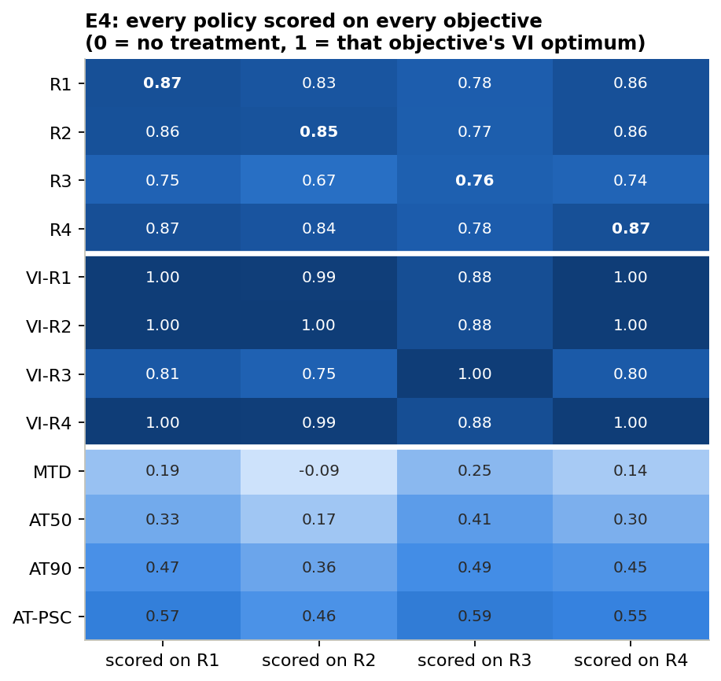

# What should adaptive therapy optimise?

*A controlled comparison of four published RL objectives for adaptive cancer therapy, all in one environment. AI in Medicine course project, Phase 3 (implementation of the Phase 2 plan).*

The RL literature on adaptive therapy uses one objective per paper, and each objective is welded to its own simulator. This project ports four of them into **one** environment and trains **one** algorithm on each. **Every agent is then scored on every metric and on every objective.** The question is whether the objective changes the learned policy, and what it costs to optimise the wrong one.

| Objective | Ported from | What it rewards |
|---|---|---|
| R1 survival + holiday | Gallagher 2023/24 (also Ma 2026) | each week alive, plus drug-free weeks |
| R2 dose + time | Gluzman 2020 | low cumulative dose and low elapsed time |
| R3 coexistence | Giles & Newton 2026 | Shannon entropy of the sensitive/resistant mix |
| R4 durability | Yao 2024 | a low resistant *fraction* after a simulated 180-day treatment holiday |

The environment is Strobl 2021's two-population Lotka–Volterra model with turnover, on Gallagher's proof-of-principle (PoP) patient. Exact reward definitions are in `experiments.ipynb` (top cell) and `decisions.md` §B.

<p align="center"></p>

The repository holds two rounds of experiments:
- **Main study (E0–E11d):** `experiments.ipynb`, with results in the sections below.
- **Follow-up round (A1–E2):** [`further_expts/`](further_expts/), which adds 14 robustness and extension experiments. They are summarised [here](#follow-up-experiments-further_expts).

**Contents:** [Headline findings](#headline-findings) · [Results by experiment](#results-by-experiment) · [Follow-up experiments](#follow-up-experiments-further_expts) · [How to run](#how-to-run) · [Layout](#layout) · [Limitations](#limitations)

---

## Headline findings

1. **The objective changes the policy, but mostly through one objective.** At the computable optimum, R1, R2 and R4 converge on the same *containment* policy: hold the tumour just below the progression line and treat only when the next week would cross it (TTP ≈ 2035 d). R3 is the outlier. It treats early to escape its entropy-boundary penalty and progresses ≈ 400 d sooner (1625 d). Among trained agents, 5 of 6 objective pairs differ in policy space beyond the seed-to-seed noise floor. The exception, R1 ≡ R4, holds for both durability definitions we tried (resistant-population regrowth, and resistant fraction after a holiday) and on both patients. **Durability is not a separate objective in this model.** Containment keeps sensitive competitors as abundant as possible, which simultaneously maximises survival and minimises resistant regrowth and resistant fraction. A larger durability weight changes the policy only by teaching the agent to give up early, and closing that loophole restores containment (E3c).
2. **Cost of the wrong objective.** Training on coexistence (R3) costs **12–18% of the achievable optimum on every other objective**. Training on survival, dose or durability costs ≤ 2% on each other.
3. **Instrumental convergence holds in reverse.** The Phase 2 headline hypothesis was that the coexistence-trained agent would outlast the survival-trained one. That fails (p = 1). Survival-trained agents instead score slightly *higher on the coexistence objective* than coexistence-trained agents do (0.78 vs 0.76 of optimum).
4. **Why coexistence underperforms.** In any patient who eventually progresses, the resistant population grows under every policy. A two-population coexistence target therefore cannot be held, and the entropy reward reduces to "treat early, then contain". It holds targets exactly only in patients who are controllable anyway (E6b).
5. **What is robust.** "R3 last" survives everything we tried:
   - held-out virtual patients (20/20);
   - ±25% parameter perturbation;
   - monthly monitoring;
   - two drug-mechanism misspecifications;
   - a full E3–E5 rerun on a patient with a cost of resistance.

   The order among R1, R2 and R4 does **not** survive, and is not claimed.
6. **RL vs the optimum.** PPO agents reach ≈ 85% of their own optimum and beat every tuned heuristic by about 50% (1740 d vs 1135 d). The exact optimum is brittle under parameter misspecification (lower-quartile TTP ≈ 110–160 d), while the agents' safety margin keeps them robust. Every learned policy fails catastrophically if monitored less often than it was trained (Gallagher's asymmetry, replicated).
7. **With a clinically realistic observation, learning is the bottleneck, not information.** Memoryless PPO agents that see only tumour burden (N/N₀) **fail to train** for every objective: 0.21–0.37 of the optimum, ≈ 700 d, about AT50 level. Yet a one-line burden rule, *treat iff N ≥ 1.17 N₀*, reaches 0.96 of the full-information optimum (E11). The cause is critic aliasing: a full-state critic fixes it (finding 8).
8. **What the agent observes matters more than what it optimises.** With a burden-only *actor* trained through a full-state *critic* (asymmetric actor–critic, E11b), all 40 agents train and every objective **beats the full-state agents**: TTP R1 1855 / R2 1801 / R3 1779 / R4 1846 d, 0.80–0.92 of the optimum. Each learns one sharp threshold, N\* ≈ 1.15–1.16. The objectives also nearly converge. A burden-only R3 cannot act on composition, so the R1–R3 gap falls from 250 d to 76 d, and the cost of the wrong objective falls from 0.12–0.18 to ≤ 0.035. **Most of the objective effect above depends on composition information a clinician does not have.**
9. **With memory, the effect partly returns, but it is driven by learning.** Give the burden-only actor an 8-week chart of burden readings and doses (E11c), and the R1–R3 gap returns to 220 d, with wrong-objective cost up to 0.105. But learning is harder: scores are 0.71–0.86, 4/10 R3 seeds fail, and seed noise is about 4×. R3's front-loaded treatment does *not* return. R2 becomes the outlier (−20% drug, −15% TTP) only because its indifference-calibrated objective is nearly flat; R1-trained agents score slightly higher on R2 itself. **The robust results across all four observation settings are narrower: R1 ≡ R4, R3 never beats R1, and the cost of the wrong objective depends on what the agent can observe (0.18 full / 0.035 burden / 0.105 burden history).**
10. **More training doesn't remove the memory effect, but doesn't vindicate it either.** At 3× budget (E11d) the memory agents learn as well as the memoryless ones (0.80–0.92; 8/10 R3 seeds), and the effect is stable: R1–R3 gap 235 d, wrong-objective cost 0.13, ordering R1 ≈ R4 > R3 > R2 fixed from 0.5M steps. **But R2- and R3-trained agents still score no better on their own objectives than survival-trained agents**, so their different behaviour is the local optimum their reward landscape leads PPO into, not a better way of serving that objective. Seed-to-seed policy noise stays about 4× the memoryless level regardless of budget.

---

## Results by experiment

| # | Question | Result |
|---|---|---|
| **E0** | Is the environment correct? | **Yes.** CT 451.6 d (paper: 450–451). AT50 662.8 d daily (paper Fig 2: 662). The paper's "672 d" is reproduced by a 28-day cadence checked only at decision points. RK4 agrees with `solve_ivp` to < 0.01 d. The Phase 2 table's f_R = 0.01 does not reproduce; the repo's 0.001 does. |
| **E1** | Where is there room to improve? | MTD 452 d, AT50 673 d, AT90 932 d, tuned AT-PSC 1135 d (it tunes itself into full-cycle containment). Ma's literal 13/30 AT-PSC fails here (80 d). On the cost × turnover plane, the best AT-x gives 2.0–3.3× MTD, and the R1 optimum adds another 2.2–6.5×. |
| **E2** | Best achievable per objective | VI ceilings: R1 2038 d, R2 2030 d, R3 1625 d, R4 2038 d. R1, R2 and R4 give the same containment policy; R3 differs. The grid value matches the simulated value to < 1%. |
| **E3** | Does each objective train? | 40/40 agents trained. Median score as a fraction of own ceiling: R1 0.87, R2 0.85, R3 0.76, R4 0.87. |
| **E4** | Cross-evaluation (core) | TTP: R1 1744, R2 1726, R3 1494, R4 1751 d (Kruskal–Wallis p = 1·10⁻⁵; R1, R2 and R4 not significantly different after Bonferroni correction). Off-diagonal loss from training on R3: 0.12–0.18. Loss among R1, R2 and R4: ≤ 0.017. |
| **E5** | Do policies differ? | Thresholds N\*: R1 1.144, R2 1.149, R3 1.084, R4 1.146 (VI: 1.174). 5/6 pairs differ beyond seed noise (permutation test, Bonferroni). R1 vs R2 have identical TTP but different policies (13% vs 4.7% action disagreement). |
| **E6** | Does coexistence mean anything with 2 populations? | f\* ∈ {0.05, 0.1, 0.25, 0.5} changes nothing on PoP (TTP ≈ 1510 d, mean f_R ≈ 0.09). VI holds f\* exactly only above Strobl's controllability bound (E6b). |
| **E7** | Does the ranking generalise? | Generalists on 20 held-out patients: 2650–2800 d (57–77% of each patient's optimum) vs AT-PSC 1600 d. PoP specialists do slightly *better*. R3 is last for 20/20 patients. The order within R1, R2 and R4 is unstable. |
| **E8** | Artefact of one parameter set? | At ±15/20/25%, agents keep 1680–1730 d (R3 1450–1500 d). The VI optimum, planning with the nominal model, collapses in its lower quartile (≈ 110–160 d). TTP rank τ vs nominal ≈ 0.45. R3-last persists. |
| **E9** | Does monitoring cadence matter? | Weekly- or daily-trained agents evaluated monthly progress at 83 d. Monthly-trained agents survive every cadence and reach 0.89–1.00 of the monthly optimum. **No daily-trained agent reached 0.7 of the daily optimum** (R3 collapsed to MTD). That reflects the fixed step budget giving 7× fewer simulated days (decisions D29), not evidence against daily monitoring. |
| **E10** | Model misspecification | Log-kill drug: agents transfer almost unchanged, and AT50 collapses to MTD (828 d). Cytostatic drug: MTD = AT50 = AT90 = 919 d and agents ≈ 1130 d, level with the re-solved optimum. R3-last survives both. |
| **E11** | What if the agent only sees burden? | Burden-only agents did not train for any objective (scores 0.21–0.37, TTP 535–863 d). They learn to treat whenever N exceeds 0.65–0.85 N₀, while the memoryless rule *treat iff N ≥ 1.17 N₀* reaches 1945 d (0.96 of the optimum). Cross-objective tests were skipped under the training rule. This is a learning failure, not an information limit. |
| **E11b** | Burden-only actor, full-state critic | **All 40 trained, and all beat the full-state agents:** TTP R1 1855 / R2 1801 / R3 1779 / R4 1846 d, scores 0.80–0.92, every policy a threshold at N\* ≈ 1.15–1.16. The objective effect shrinks: the R1–R3 gap is 76 d (250 d with full state), the wrong-objective cost ≤ 0.035, and disagreement 4–14% (13–33% with full state). 5/6 pairs still differ beyond seed noise (R1 ≡ R4). For the same objective, full-state and burden-only policies differ in every case. |
| **E11c** | Burden-only actor with memory (8-week chart), full-state critic | R1 1726 / R2 1473 / R3 1506 / R4 1731 d. Scores 0.71–0.86; R3 6/10 seeds trained. R1–R3 gap 220 d (full 250, burden-only 76); wrong-objective cost ≤ 0.105. R3's early-treatment signature does not return. R2's outlier status is a flat-objective learning artefact. Over shared charts, 4/6 pairs differ, with seed noise about 4× E11b. |
| **E11d** | Memory agents, 3× budget | R1 1845 / R2 1560 / R3 1610 / R4 1868 d. Scores 0.80–0.92 (E11b level); R3 8/10 trained. R1–R3 gap 235 d (1M: 220). Wrong-objective cost ≤ 0.133. R2 still −21% drug, −15% TTP, and R1-trained agents still beat it on R2's own objective. Seed noise unchanged (0.157). 4/6 pairs differ. |
| **E3c–E5c** | Does it hold with a cost of resistance? | **Yes.** Same patient with cost 0.42 (Zhang 2022). Every TTP is about 1.7× longer: VI-R1 3683 d, agents R1 3031 / R2 3009 / R3 2498 / R4 3024 d, tuned AT-PSC 1959 d. VI-R4 = VI-R1 again. A larger durability weight shortens TTP only through a give-up-early loophole, and with that loophole closed the optimum is containment again. Training on R3 costs 0.13–0.17 elsewhere; the others cost each other ≤ 0.005. 5/6 pairs differ in policy space, and R1 vs R4 does not. 5 of 10 R3 seeds fell below 0.7 of the optimum and were excluded. |

All numbers come from `results/summary.json`, which the notebook writes. Values are medians over seeds, with IQRs in the notebook tables.

### Figures (`figures/`)
| File | Shows |
|---|---|
| `E0_ct_vs_at50.png` | reproduction of Gallagher's CT vs AT50 |
| `E1_cost_turnover.png` | heuristic gain and headroom over Strobl's parameter plane |
| `E2_vi_policy_maps.png` | optimal treat/withhold regions per objective |
| `E3_learning_curves.png` | training stability (10 seeds) |
| `E4_score_matrix.png` | **the core result**: every policy scored on every objective |
| `E4_ttp_by_objective.png` | TTP per seed against baselines and the optimum |
| `E4_trajectories.png` | median-seed trajectory per objective |
| `E5_policy_divergence.png` | thresholds, and the KL and disagreement matrices |
| `E5_agent_policy_maps.png` | mean policy per objective with the VI boundary overlaid |
| `E6_fstar_sweep.png` | the coexistence-target sweep |
| `E7_cohort.png` | held-out patients |
| `E9_cadence.png` | train × evaluate cadence matrices |
| `E10_transfer.png` | drug-mechanism transfer |
| `E4c_cross_evaluation.png` | score matrix and TTP on the cost-0.42 patient |
| `E5c_policy_divergence.png`, `E5c_agent_policy_maps.png` | policy space on the cost-0.42 patient |
| `E11_burden_diagnosis.png` | what burden-only agents learned vs the best memoryless burden rule |
| `E11b_asymmetric_critic.png`, `E11b_cross_evaluation.png`, `E11b_policy_divergence.png` | burden-only policies trained with a full-state critic |
| `E11c_memory.png`, `E11c_cross_evaluation.png`, `E11c_policy_divergence.png` | burden-history (memory) policies: TTP and early-treatment signature across all four observation settings |
| `E11d_budget.png`, `E11d_cross_evaluation.png`, `E11d_policy_divergence.png` | memory agents at 1M vs 3M steps: learning curves, TTP, policy space |

---

## Follow-up experiments (`further_expts/`)

`further expts.txt` proposed a second round of experiments, which was run in [`further_expts/`](further_expts/). It trained 270 more PPO agents and added several value-iteration-only sweeps. It uses the same engine (`src/atrl.py`, extended with options that are off by default and verified bit-identical) and leaves `experiments.ipynb` and `results/` untouched. `further_expts/relevance.md` judges every proposed item against the Phase 2 plan.

**Reviewer attacks that no longer hold**

| Attack | Answer | Item |
|---|---|---|
| "The VI ceilings are coarse" | Doubling the grid moves no ceiling by > 0.4% | A3 |
| "One parameter set" | R1 ≡ R4 and R3 last hold over the whole cost × turnover box (25 VI patients), and for PPO on a third patient (turnover 0.04) | C1, A1 |
| "Your agents trained badly" | At 3× budget, scores reach 0.93–0.97 and divergence *grows* (R1 vs R3: 3.8× → 6.1× seed noise). R3's cost stays 0.15 with full state | A2 |
| "It is your R3 reward maths" | Smooth entropy rewards are worse, and smooth targets cannot be held by VI either: the limit is structural | B2 |
| "It assumes fully resistant cells" | R3's survival penalty stays ≈ 20% at every ε while the patient still progresses | E2 |
| "Progression at 1.2 N₀ is arbitrary" | The ranking R1 = R4 > R2 > R3 holds at 1.1, 1.2 and 1.3 | B4 |

**New insights**
1. **What the policy sees bounds what the objective can do (A2).** At an equal 3M-step budget, burden + critic beats full state for every objective (p ≤ 4·10⁻⁴), and memory is weakest. With a burden-only actor the objectives nearly collapse: R3's largest cost is 0.023, against 0.154 with full state.
2. **R2 is Pareto-efficient, not broken (B1).** All good policies lie on one drug–TTP line at ≈ 72% dose intensity. The R2 memory agents trade ≈ 285 d of TTP for ≈ 4 points of intensity.
3. **R1 ≡ R4 depends on how a holiday is credited (D1).** Adding a half dose separates survival (2038 d) from durability (2143 d), but only because R1's holiday bonus is all-or-nothing. A dose-proportional bonus (`R1p`) recovers the R4 optimum exactly. S → R conversion (E1) gives the first genuine split at the optimum, but it is small (6 d) and agents do not find it.
4. **Intermediate doses help the planner more than the learner (D1–D3).** Three dose levels add 70–105 d at the optimum and 68–168 d for agents. Five levels help VI further but *lower* PPO's scores. A single growth-halting dose (2/3) captures most of the gain.
5. **Optimal schedules chatter, and can be simplified (B3, D4).** Optima and agents switch dose on ≈ 54% of weeks, against ≤ 22% for heuristics. A switching penalty halves switching for 3–8% of the benefit, and at 9 switches a year the schedule still outlasts the best heuristic by 55%.
6. **Coexistence's cost scales with its target (B2).** A target near the containment fraction (f\* = 0.05) is nearly free (cost 0.029). Every higher target costs more, and no policy holds f above ≈ 0.12.

The full tables, figures and run instructions are in [`further_expts/README.md`](further_expts/README.md).

---

## How to run

Requirements: Python ≥ 3.10 with `numpy scipy pandas matplotlib torch jupyter`. No GPU is needed, and no RL library either: PPO is implemented in `src/atrl.py`.

```bash
python src/atrl.py                 # self-check: E0 numbers, solver agreement, reward signs
jupyter nbconvert --to notebook --execute --inplace experiments.ipynb   # or open it and Run All
```

- **First run.** Trains 315 PPO agents (10⁶ steps each; the 40 E11d agents use 3×10⁶), about 2–3 min per 10⁶ steps per core. With the default 6 parallel workers this takes about 3.5 h.
- **Memory.** Each worker imports PyTorch (about 0.5 GB), so 14 workers ran a 16 GB machine out of memory. The notebook kernel itself peaks at about 0.6 GB. Long runs can still be stopped by Claude Code when other applications leave the machine short of RAM.
- **Caching.** Checkpoints are cached in `results/agents/`. Later runs skip training, and the full notebook re-executes in about 9 min.
- **Retraining.** Delete a `.pkl` to retrain that run.
- **Reproducibility.** Seeds are fixed. The config is written to `results/config.json`. Training jobs are defined once in `atrl.jobs()`.
- **Follow-up round.** Run `python further_expts/fx.py 4` (270 jobs, about 5 h on 4 workers, resumable), then execute `further_expts/further_expts_experiments.ipynb` (about 25 min; it never trains). All checkpoints are already committed, so you can go straight to the notebook.

## Layout

```
experiments.ipynb       main study: E0 -> E11d in order, a "Reading" cell after each experiment, Findings at the end
src/atrl.py             environment, objectives, baselines, metrics, value iteration, PPO, analysis helpers (one module)
results/                agents/*.pkl (checkpoints + learning curves), per-experiment score and cross-evaluation CSVs, summary.json, config.json
figures/                every figure the main notebook draws
decisions.md            every design choice (D1-D43): alternatives, reasons, sources, what would change it
model_flow.md           the ODE, the MDP, and diagrams of how data flows to each result
further expts.txt       the follow-up proposal (parts A-G) and the rules it keeps from Phase 2
further_expts/          the follow-up round: notebook, fx.py launcher, its own results/ and figures/, decisions F0-F18, relevance.md
Docs/                   proposal, Phase 2 plan (the experiment matrix this implements), presentation decks, literature reference
  figures and code/     the figures used in the decks and the scripts that draw them
Drafts/                 early draft of the research question
References/             fetch_papers.py (downloads the open-access papers into papers/) and papers/_manifest.csv (the reading list with DOIs)
rl_adaptive_cancer_therapy.bib   BibTeX for the reading list
```

`Docs/RL_Adaptive_Cancer_Therapy_Reference.md` summarises the literature corpus. The paper PDFs are not in the repository, for copyright reasons. Run `cd References && python fetch_papers.py --email you@example.com` to download the open-access ones; the script lists the DOIs of the rest.

## Limitations

Stated up front, following Phase 2 and Part V of the reference document:

- **In silico, one model class.** Strobl's two-population, well-mixed LV model. There is no space, pharmacokinetics, mutation or plasticity, and resistance is pre-existing and binary. E10 tests only drug-mechanism misspecification.
- **Few reference patients.** The full PPO cross-evaluation was run on three patients: PoP (cost 0, turnover 0), cost 0.42 (E3c) and turnover 0.04 (follow-up A1). E7 and E8 broaden this, and the follow-up C1 map checks the VI optima over a 5 × 5 cost × turnover box. Patients outside that box were not tested.
- **Oracle observation.** The main agents see the full sensitive/resistant composition, so the comparison is about objectives, not observability (decisions D7). With a burden-only policy trained through a full-state critic (E11b), the objective effect shrinks to a few percent. So the size of the headline objective differences is specific to the oracle observation.
- **The ports are interpretations.** R2's progression penalty, R3's scaling and boundary, and R4's per-step form are our choices, not the source papers' literal rewards (decisions D11–D14). The findings are about these ports.
- **The VI ceiling is a discretised optimum.** Agents can match or slightly exceed it where dynamics are very slow (cytostatic E10).
- **No clinical claim.** This is a proof-of-concept comparison. Adaptive therapy itself is not clinically established (Mistry 2021).

## Not done (deliberately)

- Memory variants beyond E11c/E11d: an LSTM, or a longer chart (Aif uses 64 steps). More budget alone (E11d) closed the score gap but left the objective effect and the seed noise unchanged.
- Noisy or delayed burden readings (follow-up E3). This is the recommended next step, because the follow-up A2 made observation the strongest lever in the study.
- R5 toxicity (Gevertz 2026) and its rule-based baseline: optional in Phase 2; would add a third state dimension.
- E6–E10 on the cost-0.42 patient. E3c showed the E3–E5 conclusions carry over unchanged, so this was not prioritised.
- A durability objective that genuinely conflicts with survival. Neither the population nor the fraction definition does in this model (E3c, decisions D14). That would need a model mechanism that makes a large sensitive population costly, such as toxicity (R5) or burden-proportional mutation. The follow-up E1 (S → R conversion) gives the first split at the optimum, but it is small and agents do not find it.

See `decisions.md` for the full reasoning behind every choice and `model_flow.md` for the data flow.
