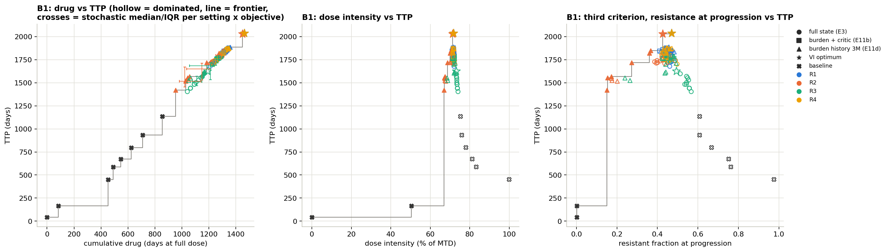

# Follow-up experiments

The second round of the project, proposed in [`../further expts.txt`](../further%20expts.txt). It stress-tests the main study's findings (E0–E11d, see the [root README](../README.md)) and extends them with graded doses, new biology and a parameter-space map.

- **What was run:** 270 new PPO agents plus value-iteration-only (VI-only) sweeps.
- **What it shares with the main study:** the engine, `../src/atrl.py`. Every extension is an option that is off by default, and the original experiments reproduce bit-identically (decisions F0).
- **What it leaves alone:** `../experiments.ipynb` and `../results/` are untouched. The original agents are reloaded read-only.

<p align="center"></p>

## Files

| File | What it holds |
|---|---|
| `further_expts_experiments.ipynb` | the analysis notebook, §0 (reproduce the published numbers) to §9 (findings). It never trains |
| `fx.py` | extra patients, every PPO job, and the switching-penalty VI. `python fx.py [workers]` trains whatever is missing |
| `relevance.md` | every proposed item judged against the Phase 2 plan: does it **defend** a claim, add a **new insight**, or neither |
| `decisions.md` | every design choice (F0–F18, continuing the root D1–D43), plus a results table |
| `model_flow.md` | the new ODE terms (μ, ε, h), patients, action sets, and how data flows to each result |
| `results/` | `agents/*.pkl` (270 checkpoints), score and cross-evaluation CSVs, `summary.json` |
| `figures/` | every figure the notebook draws |

## What was done

| Item | Question | Method | Outcome |
|---|---|---|---|
| **A1** | Does it hold with turnover > 0? | PPO + VI | Yes: R1 ≡ R4, R3 costs 0.172, R1/R2/R4 cost each other ≤ 0.025 |
| **A2** | 3× budget for every observation setting | PPO | Burden + critic > full > memory at equal budget; divergence grows with budget |
| **A3** | Are the VI ceilings fine enough? | VI | Doubling the grid moves ceilings < 0.4% |
| **B1** | Pareto frontier of drug vs TTP | analysis | All good policies lie on one drug–TTP line; R2 memory agents are Pareto-efficient |
| **B2** | Is "R3 last" an artefact of its reward shape? | PPO + VI | No: smooth rewards are worse. R3's cost scales with its target f\* |
| **B3** | How often do policies switch dose? | analysis | ≈ 54% of weeks (heuristics ≤ 22%), which triggered D4 |
| **B4** | Is progression at 1.2 N₀ arbitrary? | VI-only | Ranking unchanged at 1.1 / 1.2 / 1.3 |
| **C1** | Cost × turnover map | VI-only | R1 ≡ R4 at 25/25 patients; R3 penalty 20–23% |
| **D1** | Three dose levels | PPO + VI | +70–168 d. R1 ≢ R4 only through the all-or-nothing holiday bonus; `R1p` ≡ R4 |
| **D2** | 2 / 3 / 5 dose levels | PPO + VI | VI gains with levels, PPO loses at 5; {0, 2/3, 1} gets most of the gain |
| **D3** | Dose-response shape | VI-only | Graded-dose gain depends on the curve (R4 +56 to +112 d) |
| **D4** | Switching penalty | VI-only | Halving switches costs 3–8%; still 55% above the best heuristic |
| **E1** | S → R conversion | PPO + VI | First split of R4 from R1 at the optimum, but small and invisible to agents |
| **E2** | Partly sensitive resistant cells | VI-only | R3 penalty ≈ 20% at every ε while the patient progresses |

**Not done:** A4 (equal simulated days per cadence), A5 (E6–E10 on the cost patient), E3 (noisy or delayed readings, the recommended next step), E4 (agent picks its next visit) and Part F. `relevance.md` gives the reasons.

The full findings, and where each belongs in a paper, are in notebook §9 and `relevance.md`.

## Figures

| File | Shows |
|---|---|
| `A1_cross_evaluation.png`, `A1_policy_divergence.png` | score matrix and policy space on the turnover-0.04 patient |
| `A2_budget_curves.png` | learning curves at 1M vs 3M steps for each observation setting |
| `A2_full3M_cross_evaluation.png`, `A2_burden3M_cross_evaluation.png` | score matrices at 3M steps |
| `B1_pareto.png` | drug and intensity vs TTP frontiers |
| `B2_r3_reward_shape.png` | band vs smooth-entropy vs target-distance coexistence rewards |
| `C1_cost_turnover_map.png` | R1 ≡ R4 and the R3 penalty over the cost × turnover box |
| `D1_stage1_constant_doses.png`, `D1_vi_policy_maps.png` | constant-dose baselines and VI policies with a half dose |
| `D1_cross_evaluation.png`, `D1_policy_divergence.png` | three-dose agents: score matrix and policy space |
| `D2_cross_evaluation.png` | 2 / 3 / 5 dose levels |
| `D4_switching_penalty.png` | switches per year vs TTP under a switching penalty |
| `E1_cross_evaluation.png`, `E1_policy_divergence.png` | agents under S → R conversion |

## How to run

From the project root:

```bash
python further_expts/fx.py 4    # trains missing jobs; ~5 h on 4 workers, resumable (each job is cached as a .pkl)
jupyter nbconvert --to notebook --execute --inplace further_expts/further_expts_experiments.ipynb   # ~25 min
```

All 270 checkpoints are committed, so the first command is a no-op on a fresh clone. Each worker uses about 0.5 GB of RAM.
