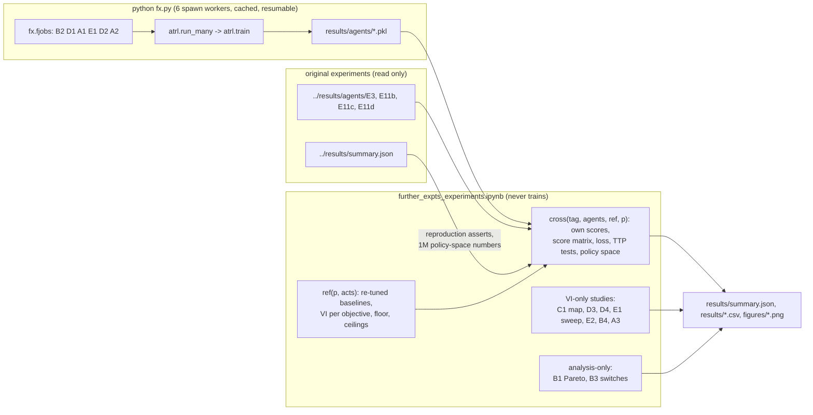
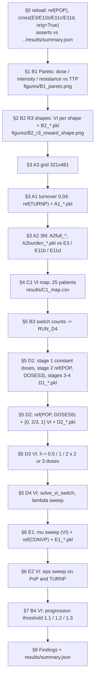

# Model flow: follow-up experiments

What changed relative to the root `model_flow.md`, and how data moves from the ODE to every number in `further_expts_experiments.ipynb`. Code references point into `../src/atrl.py` (the shared engine) and `fx.py` (this folder).

**Unchanged** (root §1–§2): Strobl's two-population LV model, the PoP patient, 7-day decisions, RK4 with dt = 0.5 d and progression checked at every substep, γ = 0.999 per week, the four objectives, PPO and its hyperparameters, the 10⁶-step budget. Every addition below is **off by default**, so the original experiments run bit-identically (decisions F0).

## 1. The tumour model, with the new optional terms

$$
\frac{dS}{dt} = r_S\,S\left(1-\frac{S+R}{K}\right)\left(1-\hat d_D\,D^{\,h}\right) - d_T S \;-\; \mu S
$$
$$
\frac{dR}{dt} = r_R\,R\left(1-\frac{S+R}{K}\right)\left(1-\varepsilon\,\hat d_D\,D^{\,h}\right) - d_T R \;+\; \mu S
$$

| New symbol | Patient key | Default (absent) | Used in | Meaning |
|---|---|---|---|---|
| μ | `mu` | 0 | E1 (μ = 3·10⁻⁵ /day; VI sweep 10⁻⁵…10⁻³) | sensitive → resistant conversion. Cells are transferred, not created |
| ε | `eps` | 0 | E2 (VI sweep 0…0.5) | drug sensitivity of resistant cells relative to sensitive ones |
| h | `h` | 1 | D3 (VI: 0.5, 2) | dose-response exponent. The effect at D = 0 and D = 1 is fixed, so binary doses are unaffected |
| progression | `CFG['prog']` | 1.2 | B4 (VI: 1.1, 1.3) | N ≥ prog·N₀ ends the episode; the VI grid spans [0.02, prog]·N₀ |

The patients used for training (`fx.py`):

| Name | Parameters | Experiment |
|---|---|---|
| `POP` | cost 0, turnover 0 | B1, B2, A2, A3, B3, D1–D4, B4 |
| `TURNP` | cost 0, **turnover 0.04** | A1 (and E2's second patient) |
| `CONVP` | PoP + **μ = 3·10⁻⁵** | E1 |
| `patient(c, u)` grid | cost {0…0.4} × turnover {0…0.04} | C1 (VI only) |

## 2. The MDP: what each experiment changes

| Element | Original | Change here |
|---|---|---|
| Action | D ∈ {0, 1} | D1: {0, 0.5, 1}; D2: {0, 0.25, 0.5, 0.75, 1}; D2 (VI only): {0, 2/3, 1}. `actions=` in `solve_vi` and `train` |
| Policy | Bernoulli logit | categorical over the doses (same 2×128 actor, one logit per dose). `ActorCritic(na=k)`, `Agent.dist()` |
| State (VI) | (N, log f) grid | D4: (previous dose, N, log f). The grid is replicated per previous dose (`fx.solve_vi_switch`) |
| Reward | R1–R4 | B2: `R3s` (smooth entropy), `R3d{f*}` (smooth log-distance to f*). D1: `R1p` (holiday bonus 0.05·(1 − D)). D4: r − λ·1[D_t ≠ D_{t−1}] |
| Budget | 10⁶ steps | A2: 3·10⁶ for the full-state and burden + critic agents |

Reward formulas (f = R/N, H = Shannon entropy in log₁₀, H_max = log₁₀ 2; progression penalty −100 as in R3):

| Objective | Per step |
|---|---|
| `R3s` | 0.1 · (2H/H_max − 1) |
| `R3d{f*}` | max(−0.1, 0.1 · (1 − abs(log₁₀(f/f*)))) |
| `R1p` | 0.1 + 0.05·(1 − D); −0.1 at progression; +5 at 30 years |

## 3. One environment step with graded doses

```mermaid
sequenceDiagram
    participant P as Policy (categorical PPO / k-action VI)
    participant E as VecEnv / rollout
    participant O as ODE (advance)
    participant Rw as reward(obj)
    P->>E: dose index i in {0..k-1} -> D = actions[i]
    E->>O: integrate 7 days at dose D (RK4, dt = 0.5 d; mu, eps, h if the patient has them)
    O-->>E: S', R', progressed?, time alive
    E->>Rw: (S', R', D, progressed, capped)
    Rw-->>E: r   (R1 bonus only if D = 0; R2 charges D; R1p charges 1 - D)
    E-->>P: features(S', R'), r, done
```

## 4. Pipeline: from jobs to claims



`load(exp)` refuses to run when a checkpoint is missing, so the notebook can never start a long training run inside the kernel.

## 5. Notebook sections, inputs and outputs



| Section | Checkpoints | Ceilings it is scored against |
|---|---|---|
| B1, B3 | original E3, E11b, E11d | E2 (binary, PoP) |
| B2 | `B2_R3s_*`, `B2_R3d{f}_*` + original E3 R1/R3 | VI re-solved per R3 shape |
| A1 | `A1_*` | VI re-solved on the turnover-0.04 patient |
| A2 | `A2full_*`, `A2burden_*` | E2 (binary, PoP) |
| D1 | `D1_*` | 3-dose VI |
| D2 | `D2_*` | 5-dose VI |
| E1 | `E1_*` | VI re-solved with conversion |
| C1, D3, D4, E2, B4, A3 | none (VI only) | each environment's own VI |

## 6. What is shared, and what is not

- **Shared by every objective within an experiment:** the environment, the action set, the integrator, the observation, PPO and its hyperparameters, the budget, the seeds, the evaluation and the analysis code. This is Phase 2 rule 2.
- **Re-solved for every environment or action-set change:** VI and therefore the ceilings, the floor (no treatment) and the re-tuned AT-PSC baseline (Phase 2 rule 3).
- **Reused from the original experiments, never retrained:** the E3, E11b, E11c and E11d checkpoints. Their reproduced numbers are asserted in §0.
