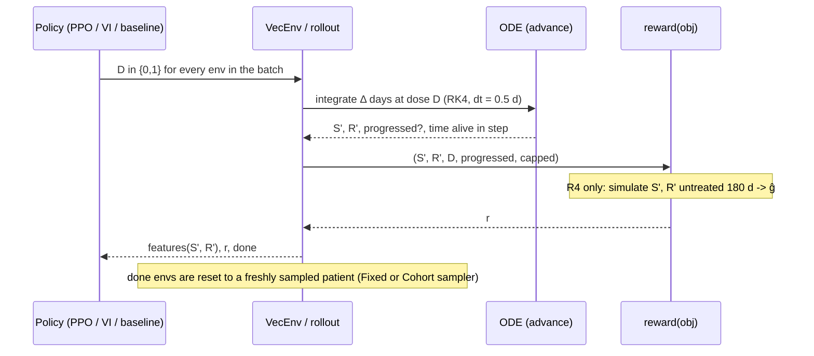
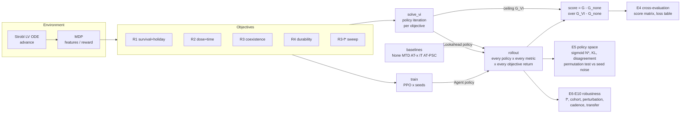
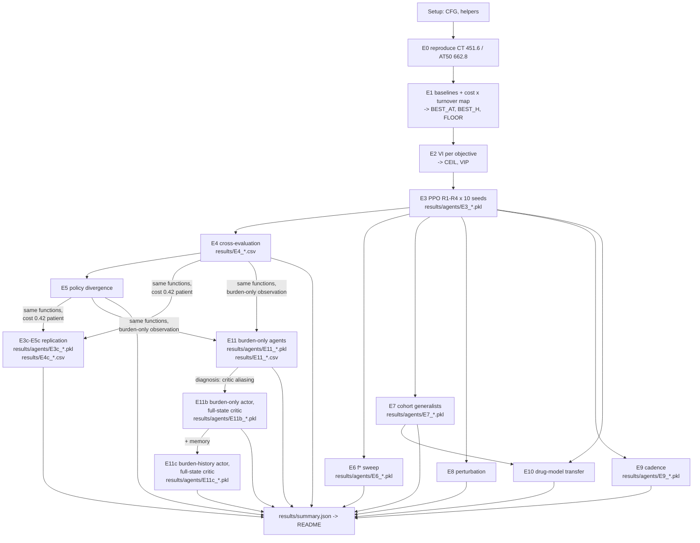

# Model flow

How data moves from the ODE to every number in the notebook. Code references point into `src/atrl.py`.

## 1. The tumour model (`deriv`, `rk4`, `advance`)

Strobl et al. 2021, in Gallagher et al. 2023's form:

$$
\frac{dS}{dt} = r_S\,S\left(1-\frac{S+R}{K}\right)\left(1-\hat d_D\,D\right) - d_T S,\qquad
\frac{dR}{dt} = r_R\,R\left(1-\frac{S+R}{K}\right) - d_T R
$$

| Symbol | Value (PoP patient) | Meaning |
|---|---|---|
| r_S | 0.027 /day | sensitive growth rate |
| r_R | r_S(1 − cost), cost = 0 | resistant growth rate |
| d_T | turnover · r_S, turnover = 0 | death rate, same for both populations |
| d̂_D | 1.5 | drug kill factor (Norton–Simon: kills dividing cells) |
| K | 1 | carrying capacity |
| N₀ | 0.75 K | initial burden |
| f_R | 0.001 | initial resistant fraction R₀/N₀ |
| progression | N ≥ 1.2 N₀ | checked at every 0.5-day RK4 substep |

E10 swaps the drug term (`drug=` argument):
- `cytostatic`: max(0, 1 − d̂_D·D)
- `logkill`: r_S·S·(1 − N/K) − κ·D·S, with κ = r_S(1 − n₀)·d̂_D

## 2. The MDP

| Element | Definition |
|---|---|
| State | (S, R), fully observed |
| Observation (`features`) | `full` (default): [N/N₀, S/K, R/K, log₁₀(R/N)/4 + 1]; `burden` (E11): [N/N₀] only; E11b: actor `burden`, critic `full` (training only); E11c: actor `burden_hist` = last 8 burden readings + last 8 doses, critic `full` |
| Action | D ∈ {0, 1}, held for one decision interval Δ (7 days; 1 or 28 in E9) |
| Transition (`advance`) | ⌈Δ/0.5⌉ RK4 substeps; stops at the substep where N crosses 1.2 N₀ (crossing time interpolated) |
| Termination | progression, or t ≥ 30 years (cap) |
| Reward (`reward`) | R1, R2, R3, R3-f*, R4, all computed from the **post-step** state, see `decisions.md` §B |
| Discount | γ_Δ = 0.999^(Δ/7) |

## 3. One environment step

## 4. Pipeline: from environment to claims

## 5. Notebook sections and the files they produce

Every figure is written to `figures/<experiment>_*.png` by the cell that draws it.

## 6. What is shared, and what is not

- **Shared by all objectives:** the environment, the integrator, the observation, the action space, PPO and its hyperparameters, the step budget, the seeds and the evaluation code. This is the Phase 2 rule that keeps the off-diagonal meaningful.
- **Differs per objective:** only `reward(obj, ...)`, and therefore each objective's VI ceiling.
- **Not shared, deliberately:** the VI planner's model in E8 and E10. It plans with the *nominal* cytotoxic model while the true patient is perturbed or uses a different drug mechanism. That model mismatch is what those experiments test.
